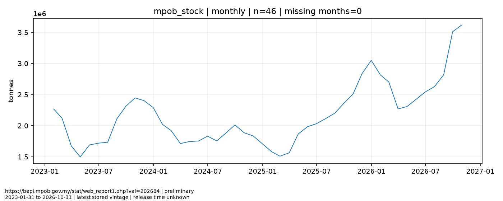
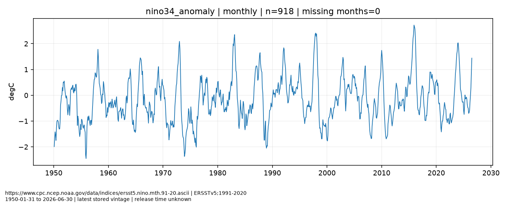

# 2026-11-13 独立数据工程验证

本报告冻结于manifest实际UTC时间，发生在北京时间08:00之后，不冒充当天07:50生产日报。现有ChatGPT 08:00任务未修改，尚未进行5个境内交易日对照。

|真实来源|已取得的历史|限制|
|---|---|---|
|MPOB|2023-01至2026-10，产量/出口/月末总库存各46个月，共138条|官方逐月发布时间未知；旧版历史修订不可倒造|
|SHFE/INE年度附件|RU与NR，2025-01-02至12-31，各243个实际交易日；合计36,093个OHLC/结算/成交/持仓字段观测|未成交合约OHLC缺失保留；没有主连收益|
|官方仓单HTML|RU仓库、NR仓库/厂库，2026-11-09至12日，共12条|只成功4天；2025仓单历史尚未取得|
|NOAA CPC|ERSSTv5 Niño3.4月异常值，1991–2020基期，1950-01至2026-06共918个月|2026-07以后未取得；不是ONI|

20项测试通过；34个成功官方文档离线重解析新增0条；MPOB与NOAA再次真实联网取数新增均0条。具体文件哈希、HTTP状态、覆盖及幂等日志见本目录CSV/JSON。单元测试使用synthetic数据，不进入真实库。6条警告来自DuckDB与Pandas3.1的弃用提示。

完整DuckDB、Parquet、每次原始快照和证据账本留在受控data/目录；公开证据账本只给3行NOAA合法小样例，不公开MPOB/交易所受限原文或完整行情库。外部S3持久化与Actions真实运行未验证。

## 历史底图验证

最新月与前月变化取真实月表；46个月仅用于检验连续历史库，不凭此自动升降评级。图中为最新存储vintage，10月标初值、9月修订；首次发现时间不等于首次官方发布。供需解释及交易含义尚需与出口、现货基差等P0证据交叉核验，当前不输出评级变化。

月度异常值保留原始频率/基期。长期气候底图只验证取数链路，最新官方文件止于6月，不能外推11月气候状态或交易方向。未提供伪季节性或欠样本分位。

九品种（含NR）查找覆盖见source_coverage.csv，未取得指标见../../docs/GAP_REGISTER.md。M1/M2整体仍未完成，不能据此称全九品种日报数据工程已上线。

## 国投期货保证金与涨跌停板监测

首次列表页面可读，后续列表/文章返回503。未取得可核实的公司投机/套保费率基线，无法核实变动；不将RU/NR自然人交割限制泛化为保证金统一上调，不报告未知旧值的变化幅度。
