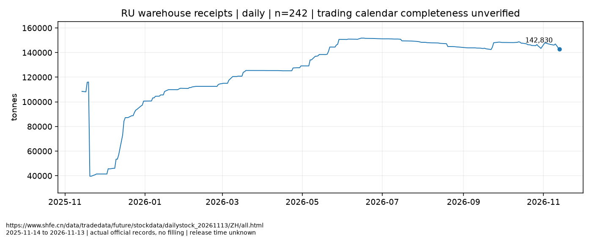
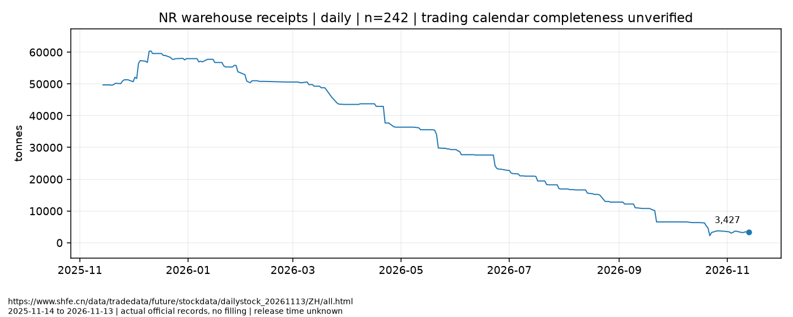
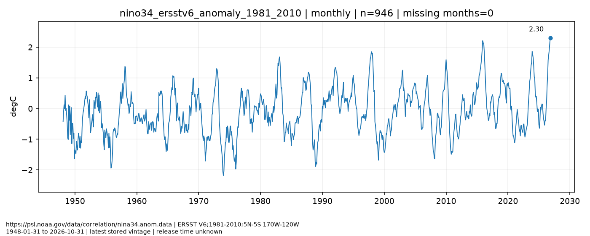

# 2026-11-16 独立数据工程验证

本轮规范库41,263条有效观测；447次原始快照哈希全部通过。报告使用manifest实际采集后UTC冻结时间，晚于北京时间08:00，不冒充当日07:50已知信息。原08:00任务未调用、未修改。

|新增/完善项目|真实覆盖|验收依据|
|---|---|---|
|RU仓库仓单|2025-11-14至2026-11-13，242个日期|官方总期号4160–4401连续，无缺期|
|NR仓库仓单|同一窗口242个日期|同一官方日报逐品种解析，吨数口径独立|
|NR厂库仓单|2026-07-24至11-13，75个日期|仅保存明确报告的厂库行；较早缺少不补零|
|NOAA ERSSTv6 Niño3.4|1948-01至2026-10，946个月，1981–2010基期|自描述页脚，独立metric_id；不拼接原V5|
|NOAA HadISST Niño3.4|1870-01至2026-09，1881个月，1981–2010基期|独立版本；-99.99缺值不写0|
|RU/NR逐合约近期增量|2026-11-09至13日|官方交易日字段；原2025全年各243交易日保留|
|国投交易提示|近12篇正文、23条关注品种事实|重复联网检查新增0；公司费率基线仍不完整|

MPOB原2023-01至2026-10三指标各46个月、CPC原V5/1991–2020的1950-01至2026-06共918个月均保留，本轮复取新增0。PSL旧说明页仍写V5，当前原文件页脚已写V6；版本冲突显式记录，不用旧网页说明覆盖原数据身份。

42项自动化测试通过，6条为DuckDB/Pandas依赖弃用提示。242份仓单文档及两份PSL文件离线重解析均新增0；两个PSL序列再次联网取数新增0。官方期号与每次原始文件哈希交叉校验，未使用工作日近似证明完整性。HTTP404日期仍保留尝试记录，不擅自归因官方节假日。10份四位小数厂库格式错误已从原始文件修复，原始失败日志保留。

## 真实历史图

242期真实日度仓库仓单，未填充缺值。仓单是已注册交割凭证，注销不自动等于社会库存去化。图用于验证历史库与当前观测位置，不据此单独调整研究评级或推导交易收益。

NR仓库与厂库分别存储；本图仅仓库，不合并成“全部NR库存”，也不替代青岛社会库存。75期厂库数据的覆盖另列，缺少的厂库行不能视为0。

月度频率、1981–2010基期、ERSSTv6版本均固定。它和原CPC V5/1991–2020指标不可直接拼接；来源说明仍有版本冲突，原文页脚与文档快照均保留。图是独立验证底图，不代表2026-11-16当天首次公布或CTA评级变化。HadISST的独立底图见charts目录。

## 增量与持久化边界

`collect`默认获取近7个候选日的日结文件，不默认重下载全年附件；历史`backfill --resume`先核验已有快照哈希后跳过，不替代修订监测。离线回放旧文件不会生成虚假回改；实际联网A→B→A仍保存新vintage及本次fetch_attempt血缘。

完整DuckDB/Parquet、原始文件及完整账本保留在受控data目录。公开账本仅含少量NOAA样例，不重新分发受限完整行情或公告正文。S3、Actions真实采集与五个境内交易日并行对照未部署/完成。CZCE/DCE、其他P0产业指标、主力换月收益、同地现货基差仍见缺口清单，M2未完成。

## 国投期货保证金及涨跌停板监测

已核对12篇官方正文，公布日与标题适用日分存；时间只精确到天时不伪造published_at。23条是本库提取的事实，不能叫“今日官方新增”。11月9日提示中的RU2611/NR2611自然人持仓归零、11月16日提示中的最后交易日均为交割限制；11月12日提示分别列出的22%是正文数值，但未明确公司/交易所与投机/套保范围，保持unknown，不默认归入公司客户标准。旧值和变化幅度均NULL。

risk_facts.csv保留独立条款类型和来源；risk_qa.json对九品种（含NR）逐一给出核查覆盖。完整客户费率基线、主力/2701全面核查仍未完成，不能宣称全站保证金或涨跌停板均无变化。
